# AWS Lambda Power Tuning: faster *and* cheaper with more memory

<p align="center">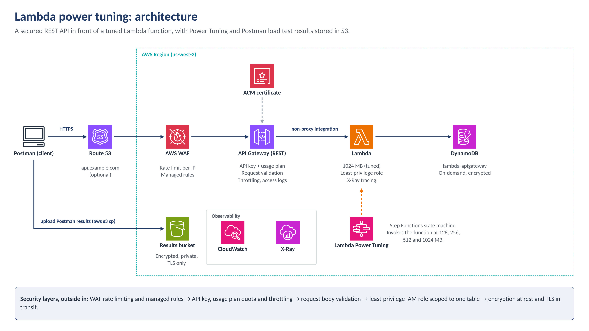</p>

## What this project is about

A serverless API (Amazon API Gateway → AWS Lambda → Amazon DynamoDB), tuned, load tested and secured end to end. It answers one question with real data: **does giving a Lambda function more memory always cost more?** For this function, it doesn't. More memory made it faster *and* cheaper.

What's covered:

| Area | What was done |
|---|---|
| **Lambda Power Tuning** | Ran the open-source [AWS Lambda Power Tuning](https://github.com/alexcasalboni/aws-lambda-power-tuning) state machine at 128, 256, 512 and 1024 MB to find the cheapest and fastest setting |
| **API load testing** | Load tested the API with Postman at **three memory settings** (128, 512 and 1024 MB): same request, 10 virtual users, 2 minutes each |
| **Cost optimization** | Compared cost per call at each memory size, projected monthly cost, and looked at the full bill (API Gateway, WAF, DynamoDB) |
| **API security** | AWS WAF (rate limiting and managed rules), API key with usage plan and quota, throttling, request validation, least-privilege IAM, encryption |
| **Custom domain** | `api.example.com` on API Gateway with an ACM certificate (automatic DNS validation) and a Route 53 alias record |
| **Test results in S3** | Postman and Power Tuning results stored in a private, encrypted, versioned S3 bucket |
| **Infrastructure as code** | Everything deploys from one CloudFormation template, with scripts to deploy, test, tune, upload results and clean up |
| **Observability** | CloudWatch access logs and metrics, plus X-Ray tracing on API Gateway and Lambda |

## Results at a glance

| | 128 MB | 512 MB | 1024 MB | 128 → 1024 MB |
|---|---|---|---|---|
| Avg duration (Power Tuning) | 2,137 ms | 215 ms | **50 ms** | 42x faster |
| Compute cost per 1M calls | $4.45 | $1.79 | **$0.84** | 81% cheaper |
| Avg response (load test) | 410 ms | 196 ms | **169 ms** | 2.4x faster |
| P99 response (load test) | 929 ms | 325 ms | **258 ms** | 3.6x faster |
| Requests served in 2 min | 1,930 | 3,746 | **4,277** | 2.2x more |
| Errors | 0% | 0% | 0% | |

**8x the memory, about 81% lower compute cost.** In Lambda, memory also controls CPU, and you pay for allocated memory multiplied by duration. When duration drops faster than memory rises, the bill goes down.

512 MB already gets most of the speed-up in the load test, but 1024 MB is still faster at the tail and costs about half as much per call, so 1024 MB is the setting we kept.

<p align="center">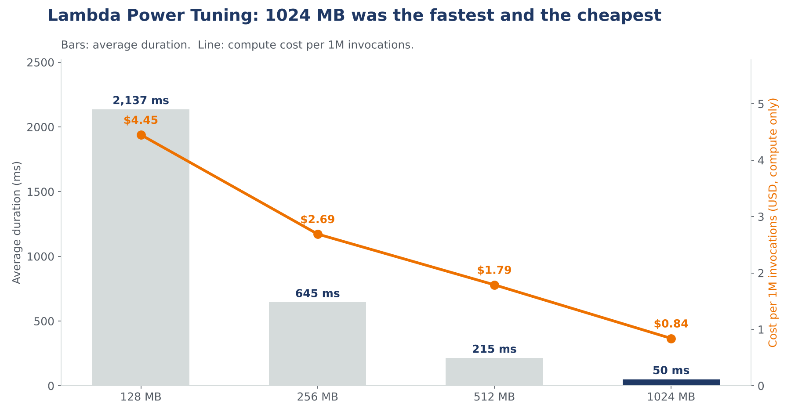</p>
<p align="center">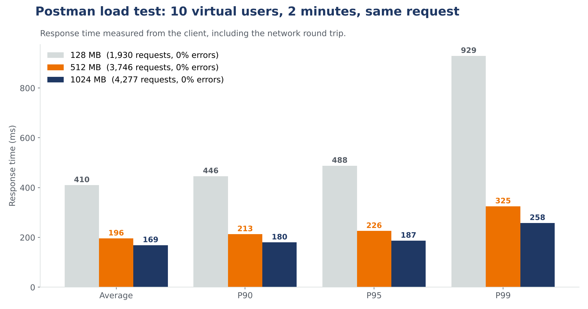</p>

## Architecture

The diagram at the top shows the full setup. Editable source: [`docs/architecture.drawio`](docs/architecture.drawio) (open in [diagrams.net](https://app.diagrams.net)).

| Component | Role |
|---|---|
| Postman | Functional tests and the performance (load) test |
| Route 53 + ACM *(optional)* | Custom domain `api.example.com` with a TLS 1.2 certificate |
| AWS WAF | Per-IP rate limiting and AWS managed rule groups |
| API Gateway (REST, regional) | `POST /DynamoDBManager`, API key, usage plan, request validation, throttling, access logs |
| Lambda `LambdaFunctionOverHttps` | Python 3.13, 1024 MB, X-Ray tracing, least-privilege role |
| DynamoDB `lambda-apigateway` | On-demand, encrypted, point-in-time recovery |
| Step Functions (Power Tuning) | Invokes the function at each memory size and reports cost and speed |
| S3 results bucket | Private, encrypted, versioned, TLS-only storage for test results |
| CloudWatch + X-Ray | Logs, metrics and traces |

## Walkthrough (screenshots from the actual run)

> The AWS account ID has been blacked out in every screenshot.

### 1. The function

`LambdaFunctionOverHttps`, triggered by API Gateway, running at the tuned 1024 MB with a 5 second timeout.

<p align="center">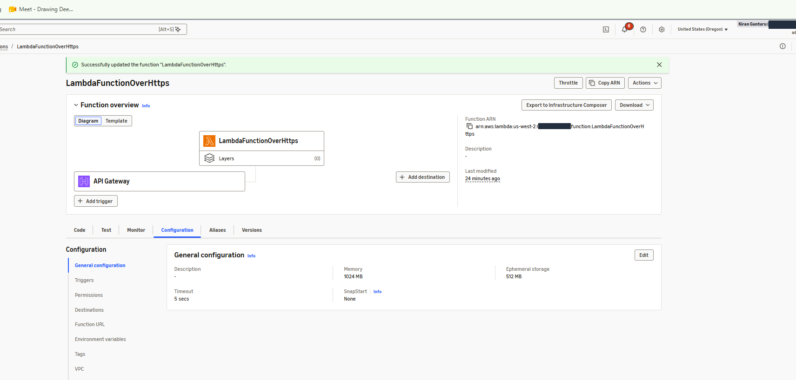</p>

### 2. The API

`POST /DynamoDBManager` on the `DynamoDBOperations` REST API, using a non-proxy Lambda integration (Lambda proxy integration = False).

<p align="center">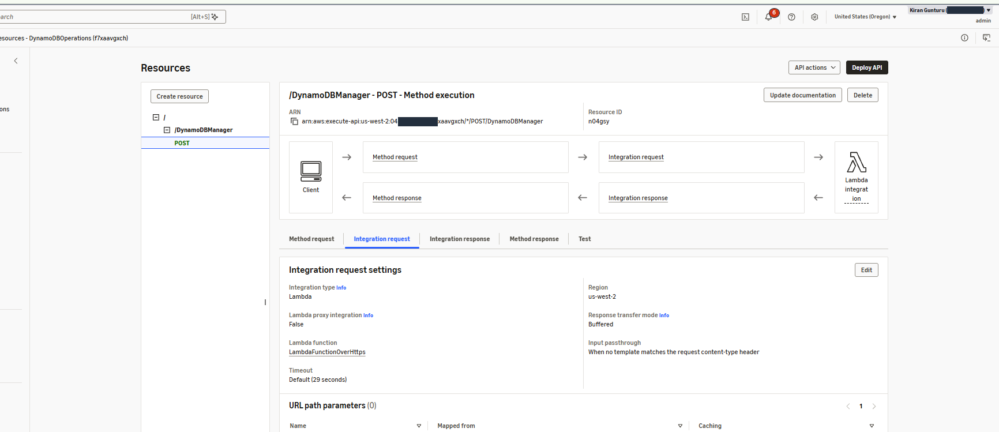</p>

### 3. The table

`lambda-apigateway`, partition key `id`, on-demand capacity.

<p align="center">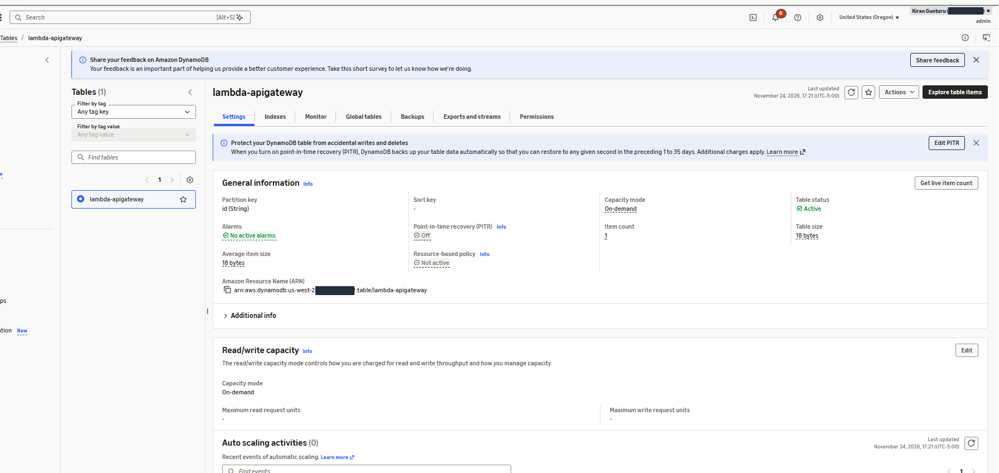</p>

### 4. Power Tuning run

The Step Functions execution: the input tests 128, 256, 512 and 1024 MB with 10 invocations each, and the output recommends **1024 MB** at about 50 ms per invocation.

<p align="center">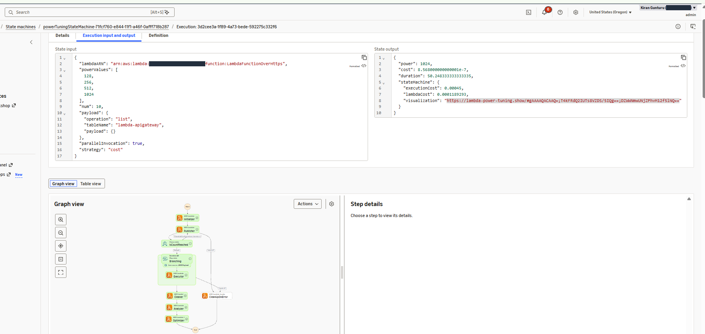</p>

<p align="center">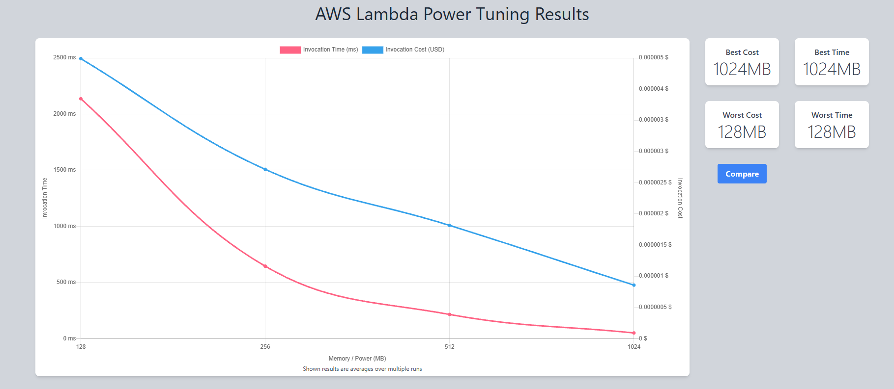</p>

### 5. Load test at 128 MB

10 virtual users for 2 minutes: 1,930 requests, 410 ms average, 929 ms P99, 0% errors. Note the early spike from cold starts.

<p align="center">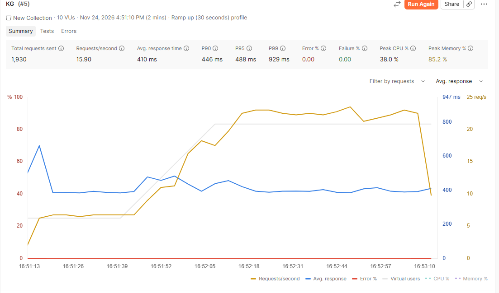</p>

### 6. Load test at 512 MB

Same test: 3,746 requests, 196 ms average, 325 ms P99, 0% errors. Most of the improvement already shows up here.

<p align="center">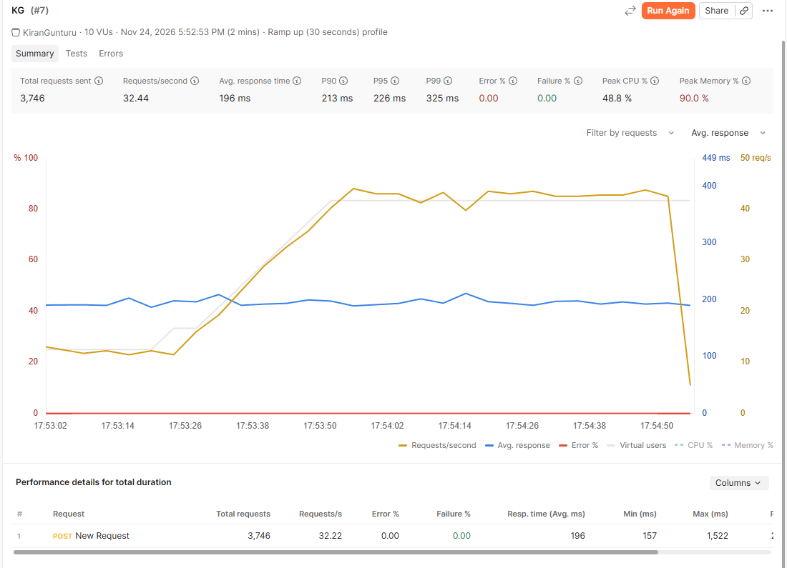</p>

### 7. Load test at 1024 MB

Same test: 4,277 requests, 169 ms average, 258 ms P99, 0% errors. Faster, and much more consistent.

<p align="center">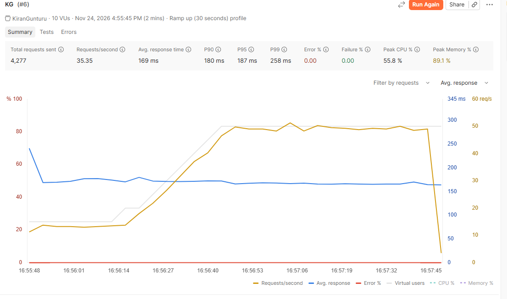</p>

The two mistakes I made along the way, with screenshots, are in [docs/load-testing.md](docs/load-testing.md#lessons-learned-mistakes-worth-sharing).

## Repository layout

```
.
├── infrastructure/template.yaml      CloudFormation: API, Lambda, DynamoDB, WAF, custom domain, results bucket
├── src/lambda_function.py            The function (create, read, update, delete, list, echo, ping)
├── tests/                            Unit tests (pytest + moto)
├── power-tuning/                     Power Tuning input, results and notes
├── load-testing/
│   ├── postman/                      Collection and environment template
│   └── results/                      Summaries of the 128, 512 and 1024 MB runs
├── scripts/                          deploy, test, set memory, power tuning, upload results, cleanup, charts
└── docs/                             Architecture, cost optimization, security, custom domain, load testing
    └── screenshots/                  Console and Postman screenshots from the actual run (account ID redacted)
```

## Deploy

Prerequisites: AWS CLI v2 configured, bash, Python 3. Default Region is `us-west-2`.

```bash
./scripts/deploy.sh                          # 1024 MB, WAF on, no custom domain
./scripts/test-api.sh                        # 200 for valid calls, 403 without a key, 400 for bad input
```

Useful options (environment variables for `deploy.sh`):

| Variable | Default | Purpose |
|---|---|---|
| `MEMORY` | 1024 | Lambda memory in MB |
| `ENABLE_WAF` | true | Attach the WAF web ACL |
| `WAF_RATE_LIMIT` | 2000 | Requests per IP per 5 minutes. Raise to 20000 while load testing |
| `DOMAIN`, `ZONE_ID` | empty | Custom domain and Route 53 hosted zone ID |
| `SET_APIGW_LOG_ROLE` | true | Set the account-level API Gateway CloudWatch role. Use false if your account already has one |

## Reproduce the tests

```bash
# Power Tuning
./scripts/power-tuning.sh deploy
./scripts/power-tuning.sh run

# Load test: run the Postman performance test after each of these
./scripts/set-memory.sh 128
./scripts/set-memory.sh 1024

# Keep the evidence
./scripts/upload-results.sh
```

Details: [power tuning](power-tuning/README.md) · [load testing](docs/load-testing.md)

## Cost optimization

- Tuning memory cut Lambda compute cost by about 81% and made the API faster.
- Once Lambda is tuned, API Gateway and WAF are the larger line items. The [cost guide](docs/cost-optimization.md) covers HTTP API vs REST API, Graviton, Scan vs Query and caching.
- 1024 MB was the largest size tested, so the next step is testing 1536 to 3008 MB to find where the savings stop.

## Security

Ten layers, from WAF at the edge to a role that can touch exactly one table. Requests without an API key never reach Lambda, and malformed bodies are rejected by API Gateway before they cost anything. See [docs/security.md](docs/security.md).

## Custom domain

Pass a domain and hosted zone, and the stack creates the ACM certificate (with automatic DNS validation), the regional custom domain, the base path mapping and the Route 53 alias. See [docs/custom-domain.md](docs/custom-domain.md).

```bash
DOMAIN=api.example.com ZONE_ID=Z0123456789ABCDEFGHIJ ./scripts/deploy.sh
```

## Lessons learned

- **Measure, don't guess.** The default 128 MB was the slowest *and* most expensive setting for this function.
- **Look at the tail, not just the average.** The P99 improvement (3.6x) was bigger than the average improvement (2.4x).
- **An API ARN is not a URL.** Postman needs the invoke URL.
- **Save before you load test.** Postman's performance runner uses the saved request. An unsaved fix produced a run with 100% errors and 1 ms responses.
- **Your own WAF can block your load test.** Plan for it.

## Clean up

```bash
./scripts/cleanup.sh                    # deletes the stack, keeps the results bucket
./scripts/cleanup.sh --purge-results    # also empties and deletes the results bucket
```

## Notes

- Results were captured in us-west-2 on x86_64, against the console-built version of this stack (same function, table, request and API). The template reproduces it and adds the security layers on top.
- Prices are AWS list prices at the time of writing. Check the AWS pricing pages before relying on them.

## Author

**Kiran Gunturu**: [GitHub](https://github.com/KiranGunturu) · [dev.to](https://dev.to/kiran_gunturu_022085015ec)

## License

MIT, see [LICENSE](LICENSE).
