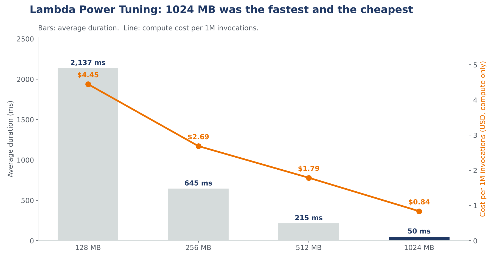

# Cost optimization

## How Lambda is billed

Every invocation is billed for two things:

1. **A request charge** of $0.20 per million requests. This is the same at every memory size.
2. **A compute charge**: the memory you **allocate** (not the memory you use) multiplied by how long the function runs, in GB-seconds. In us-west-2 on x86_64 this is $0.0000166667 per GB-second, billed per millisecond.

Memory also decides how much CPU the function gets. So raising memory makes the function more expensive per millisecond, but it can make it run for far fewer milliseconds. When duration drops faster than memory rises, the total cost goes **down**.

## What we measured

From the Power Tuning run (10 invocations per setting, durations averaged):

| Memory | Avg duration | GB-seconds per call | Compute cost per 1M calls |
|---|---|---|---|
| 128 MB | 2,136.6 ms | 0.2671 | $4.45 |
| 256 MB | 644.9 ms | 0.1612 | $2.69 |
| 512 MB | 215.0 ms | 0.1075 | $1.79 |
| **1024 MB** | **50.2 ms** | **0.0502** | **$0.84** |



Going from 128 MB to 1024 MB made the function about **42x faster** and cut compute cost by about **81%**. 8x the memory, a fraction of the cost.

> Why so dramatic for this function? At 128 MB, Lambda gives the function only a small share of a vCPU. Work like initializing the AWS SDK, the TLS handshake with DynamoDB and JSON serialization is CPU-bound, so it likely accounts for most of the 2.1 seconds. With 1024 MB the same work finishes in about 50 ms. X-Ray traces (enabled in the template) show the breakdown for your own runs.

## What it means per month

Compute plus the $0.20 request charge, at the measured averages:

| Monthly requests | 128 MB | 512 MB | 1024 MB |
|---|---|---|---|
| 1 million | $4.65 | $1.99 | $1.04 |
| 10 million | $46.50 | $19.90 | $10.40 |
| 100 million | $465 | $199 | $104 |

## Look at the whole bill, not just Lambda

Once the function is tuned, Lambda is no longer the biggest line item. For 1 million requests a month in us-west-2 (list prices at the time of writing, check the AWS pricing pages before you rely on them):

| Service | Approx. monthly cost | Note |
|---|---|---|
| API Gateway REST API | $3.50 | $3.50 per million requests |
| Lambda (1024 MB, tuned) | $1.04 | down from $4.65 at 128 MB |
| AWS WAF | about $9.60 | $5 per web ACL + $1 per rule + $0.60 per million requests |
| DynamoDB on-demand | depends on reads | the `list` operation is a Scan, so cost grows with table size |

Ideas if cost matters more than features:

- **HTTP API instead of REST API** costs about $1.00 per million requests. The trade-off: HTTP APIs do not support API keys, usage plans, request body validation or a direct WAF association, all of which this project uses for security. Put CloudFront in front of an HTTP API if you need WAF and caching.
- **arm64 (Graviton)** is about 20% cheaper per GB-second. Re-run Power Tuning on arm64 before switching, because performance can differ.
- **Replace Scan with Query** once the table grows. A Scan reads (and bills for) every item it touches.
- **Cache repeated reads.** REST APIs support stage caching; it has its own hourly charge, so it pays off only at steady, read-heavy traffic.

## Next experiment

1024 MB was both the cheapest and the fastest setting, and it was also the **largest value tested**. That means the curve may still be going down. Re-run Power Tuning with:

```json
"powerValues": [512, 1024, 1536, 2048, 3008]
```

Somewhere above 1024 MB the duration will stop improving much, and from there each extra MB only adds cost. That point is the real sweet spot.
