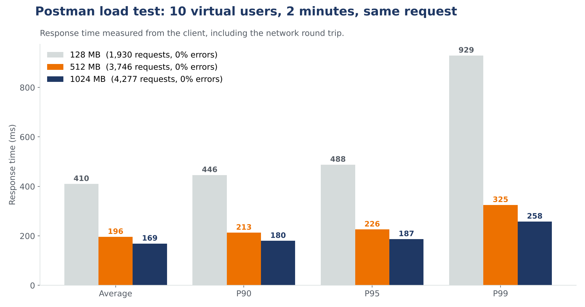
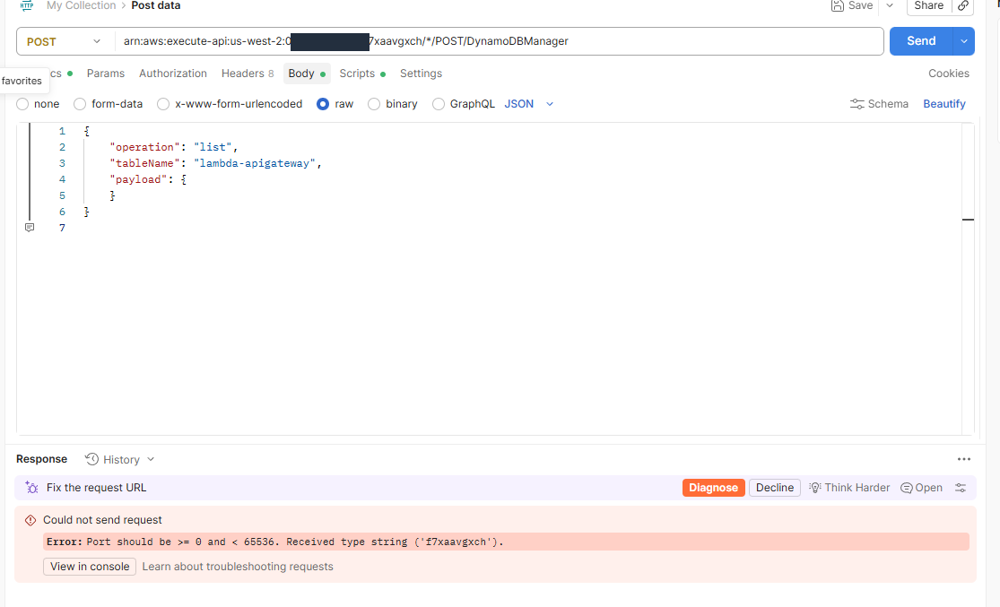
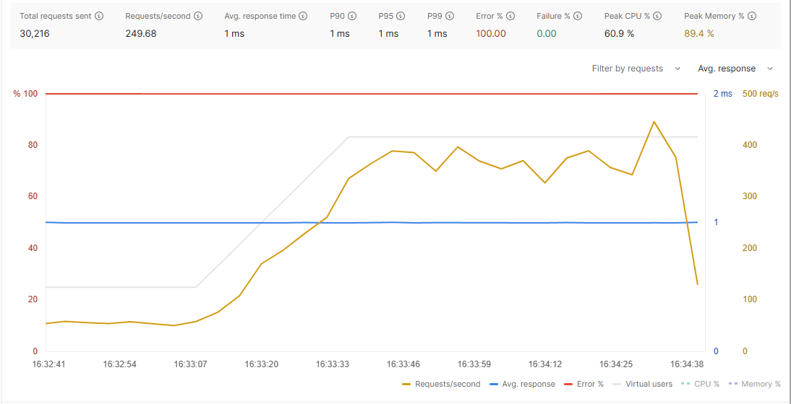
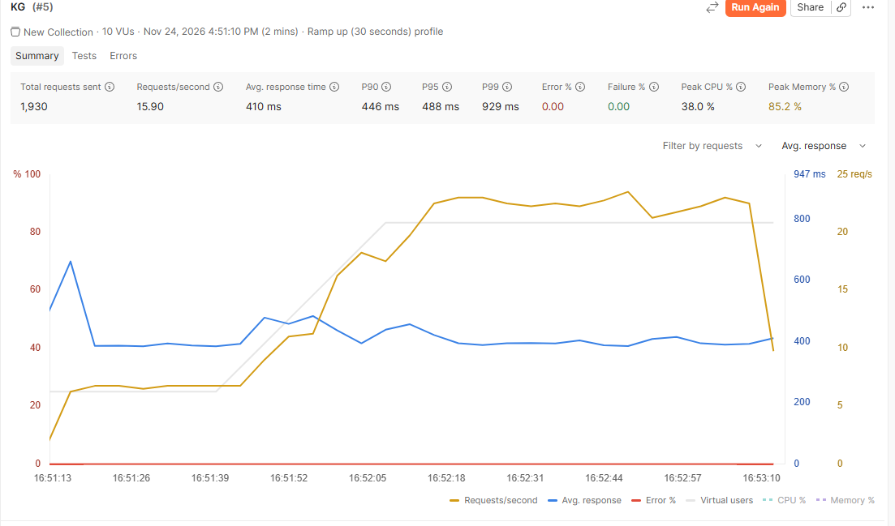
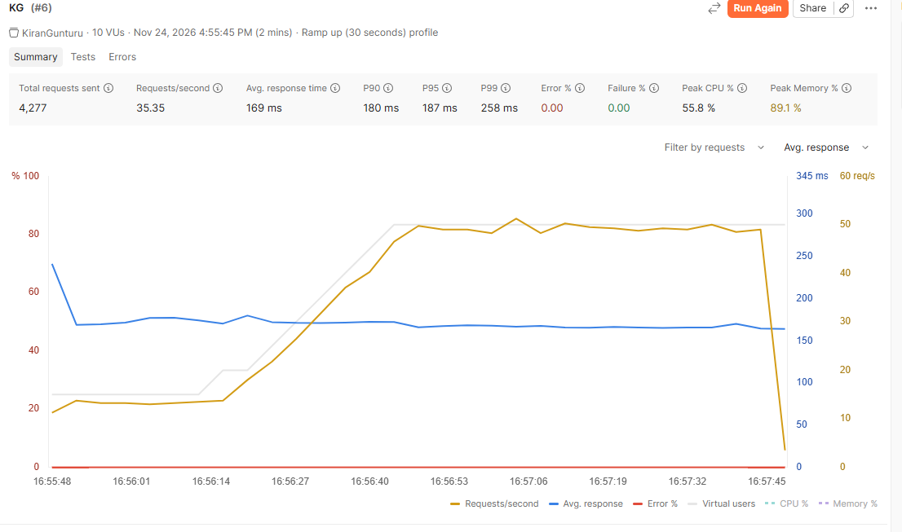

# Load testing with Postman

## Setup

1. Import `load-testing/postman/DynamoDBManager.postman_collection.json`.
2. Import `load-testing/postman/environment.template.postman_environment.json`, then set:
   - `baseUrl`: the `InvokeUrl` stack output **without** `/DynamoDBManager`, for example `https://abc123.execute-api.us-west-2.amazonaws.com/prod`
   - `apiKey`: from `aws apigateway get-api-key --api-key <ApiKeyId> --include-value --query value --output text`
3. Send **List items** once by hand. It must return 200 before you load test.
4. Open the collection, choose **Run > Performance**, and use:
   - Load profile: **Ramp up**, 10 virtual users, 2 minutes, 30 second ramp-up
   - Requests: **Load test > List items** only

## Test plan

Run the same profile twice, changing only the memory:

```bash
./scripts/set-memory.sh 128     # run the test
./scripts/set-memory.sh 1024    # run the test again
```

Wait a minute after each memory change. Updating the configuration creates fresh execution environments, so both runs start cold in the same way.

## Results

| Metric | 128 MB | 1024 MB | Change |
|---|---|---|---|
| Requests served | 1,930 | 4,277 | 2.2x more |
| Requests per second | 15.9 | 35.4 | 2.2x more |
| Average response | 410 ms | 169 ms | 2.4x faster |
| P90 | 446 ms | 180 ms | 2.5x faster |
| P95 | 488 ms | 187 ms | 2.6x faster |
| P99 | 929 ms | 258 ms | 3.6x faster |
| Errors | 0% | 0% | |



Raw summaries: `load-testing/results/summary-128mb.json` and `summary-1024mb.json`.

### Reading the numbers

- **P90 / P95 / P99** mean 90%, 95% and 99% of requests finished faster than that value. They show what the slowest users experience, which an average hides.
- **The tail improved most.** At 128 MB the gap between P90 and P99 was 483 ms (cold starts and CPU-starved requests). At 1024 MB it was 78 ms, so almost every user got the same fast response.
- **Throughput rose with the same 10 users** because each user waits for a response before sending the next request. Faster responses mean more requests in the same two minutes.
- **Response time includes the network.** Postman measures from the client machine to us-west-2 and back. For time spent inside the function only, use the Lambda **Duration** metric in CloudWatch.
- **Peak CPU and memory in the Postman report describe the client machine, not Lambda.**

## Lessons learned (mistakes worth sharing)

| Symptom | Cause | Fix |
|---|---|---|
| `Port should be >= 0 and < 65536` | The request URL was the API **ARN** (`arn:aws:execute-api:...`), not the invoke URL | Use `https://<api-id>.execute-api.<region>.amazonaws.com/<stage>/DynamoDBManager` |
| Load test shows **100% errors** and **1 ms** response time, but a single request works | The performance runner uses the **saved** request. The URL fix hadn't been saved, so every request failed before leaving the machine | Save the request (Ctrl+S), then re-run |
| Requests start failing with 403 partway through a test | WAF rate-based rule blocking the test machine's IP | Raise `WafRateLimit` or set the rule to Count while testing |
| Some requests fail with 429 | Usage plan or stage throttling, or the account's Lambda concurrency limit (new accounts can be very low) | Check the usage plan, the stage throttling and **Service Quotas > Lambda > Concurrent executions** |

### Mistake 1: using the API ARN as the URL

The ARN from the API Gateway console looks like an address, but it isn't one. Postman read `arn:aws:execute-api:us-west-2` as a host and port and refused to send the request.

<p align="center"></p>

### Mistake 2: load testing an unsaved request

After fixing the URL, a single request returned 200, but the performance run showed **100% errors with a 1 ms response time**. The runner was still using the saved request with the ARN. A 1 ms response is the giveaway: nothing ever left the machine.

<p align="center"></p>

### The successful runs

<p align="center"></p>
<p align="center"></p>

## Store the results in S3

```bash
./scripts/upload-results.sh                          # summaries + power tuning results
./scripts/upload-results.sh ~/Downloads/run-6.json   # also upload an exported Postman run
```

Files go to `s3://<ResultsBucketName>/runs/<date>/`. The bucket is private, encrypted, versioned, TLS-only, and moves objects to Standard-IA after 30 days.
