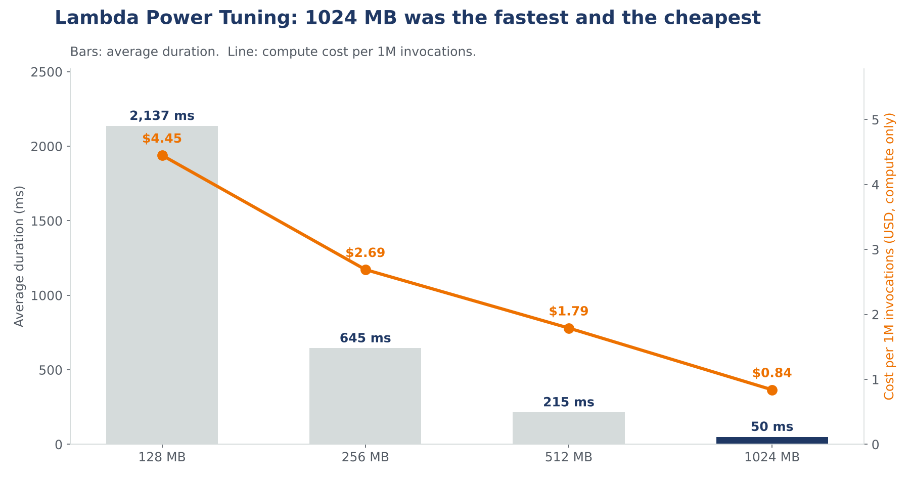
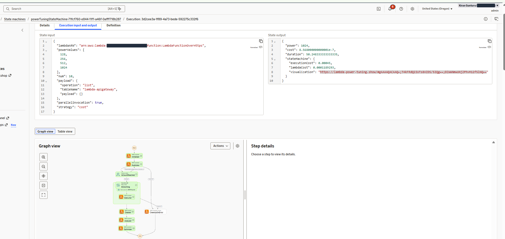
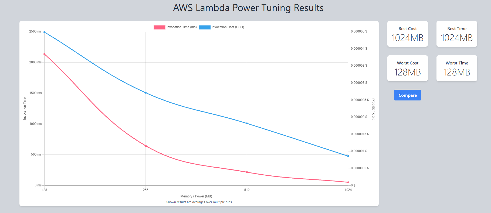

# Power Tuning

[AWS Lambda Power Tuning](https://github.com/alexcasalboni/aws-lambda-power-tuning) is an open-source Step Functions state machine. It invokes your function several times at each memory setting, then reports the average duration and cost for each one.

## Run it

```bash
./scripts/power-tuning.sh deploy   # one time: installs the state machine from the Serverless Application Repository
./scripts/power-tuning.sh run      # runs it against LambdaFunctionOverHttps using input.json
```

`input.json`:

| Field | Value | Why |
|---|---|---|
| `powerValues` | 128, 256, 512, 1024 | Memory settings to test |
| `num` | 10 | Invocations per setting, averaged |
| `payload` | the same `list` request used in the load test | Tune with a realistic request |
| `parallelInvocation` | true | Faster run. Counts more cold starts, so durations are a little pessimistic |
| `strategy` | cost | Recommend the cheapest setting |

## Result

| Memory | Avg duration | Est. compute cost per invocation |
|---|---|---|
| 128 MB | 2,136.6 ms | $0.00000445 |
| 256 MB | 644.9 ms | $0.00000269 |
| 512 MB | 215.0 ms | $0.00000179 |
| **1024 MB** | **50.2 ms** | **$0.00000084** |

**Recommendation: 1024 MB**, which was both the cheapest and the fastest. Full data, including the tool's raw output, is in `results.json`.



The actual run (account ID blacked out):





> Power Tuning durations here are longer than the load test response times at 128 MB because each Power Tuning batch includes cold starts on freshly published versions, and only 10 invocations are averaged. The load test averages almost 2,000 mostly warm requests. Both show the same trend.

Running Power Tuning itself is cheap: this run cost about $0.00045 in Step Functions and $0.00012 in Lambda.
